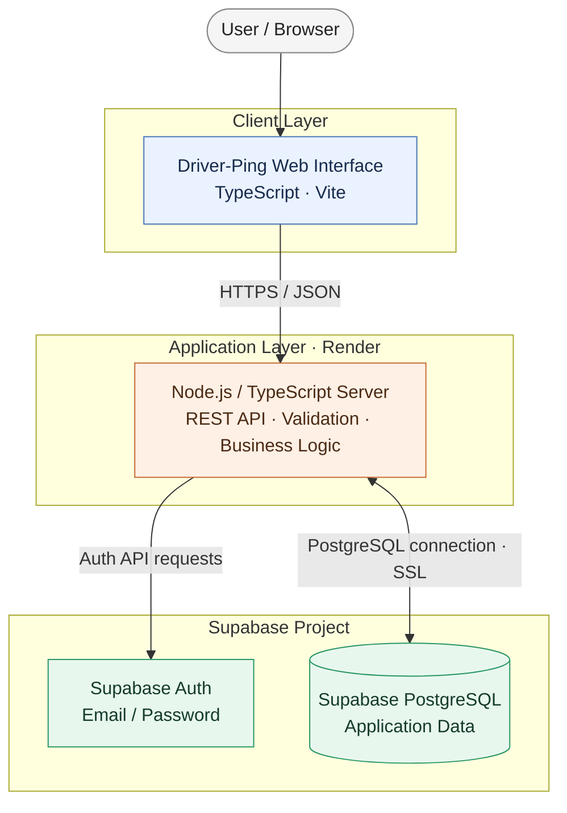
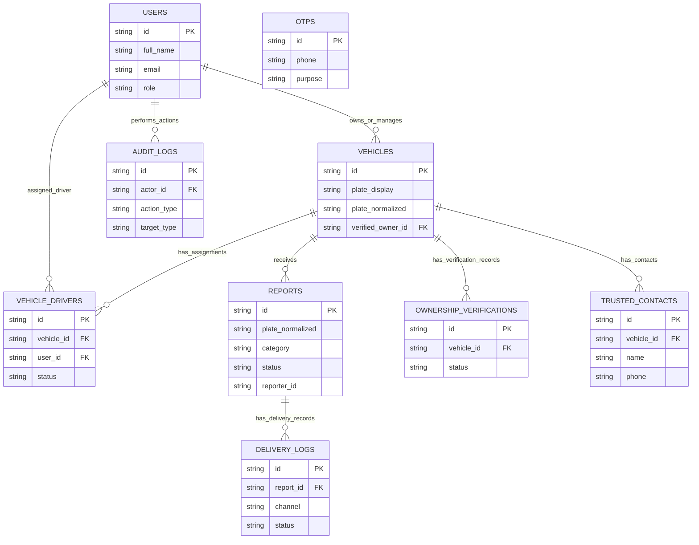

 <div align="center">

# 🚗 Driver-Ping

**Real-time driver alerts and vehicle reporting**

A web platform for reporting vehicle-related incidents, notifying registered drivers, and managing ownership and driver relationships.

[](https://www.typescriptlang.org/)
[](https://nodejs.org/)
[](https://www.postgresql.org/)
[](https://supabase.com/)
[](LICENSE)

[**Live Application**](https://driver-ping-9vig.onrender.com) · [**GitHub Repository**](https://github.com/Soquixx/Driver-ping)

</div>

---

## Overview

Driver-Ping connects people reporting vehicle-related incidents with the
registered drivers and owners who may need to respond. It combines
vehicle registration, driver assignments, incident reports, alert
actions, ownership-verification workflows, trusted contacts, and audit
records.

The application uses a TypeScript/Node.js server, PostgreSQL hosted by
Supabase, and Supabase Auth for email/password identity verification.

## Key features

-   **Driver Ping system** --- submit a vehicle-related report and
    record delivery status for eligible recipients.
-   **Vehicle ownership verification** --- manage ownership evidence and
    verification workflows.
-   **Driver management** --- associate drivers with vehicles and
    support owner-controlled approval actions.
-   **Incident reports and alerts** --- review reports and handle
    actions such as resolve, dismiss, dispute, or flag abuse.
-   **Delivery logs** --- track recorded delivery attempts and their
    statuses.
-   **Trusted contacts** --- store trusted-contact details with consent.
-   **Audit logs** --- retain records of significant application
    actions.
-   **Authentication** --- support email/password signup and sign-in
    through Supabase Auth.

Feature availability depends on the current application configuration
and external services that have been configured.

## System architecture



### Request flow

1.  A user interacts with the web interface.
2.  The client sends an HTTPS request to the Node.js API.
3.  The server validates the request and checks authentication for
    protected operations.
4.  The API communicates with Supabase Auth as needed and reads or
    writes application records in PostgreSQL.
5.  The API returns a response to the client.

## Database schema

The application database is hosted on **Supabase PostgreSQL**. The
following table names were identified in the project schema;
descriptions summarize their apparent responsibilities.

| Table | Purpose |
|---|---|
| `users` | Application user profiles and preferences |
| `vehicles` | Registered vehicle records |
| `vehicle_drivers` | Driver-to-vehicle associations and approval status |
| `reports` | Vehicle-related incident reports |
| `delivery_logs` | Report delivery channels, recipients, and statuses |
| `ownership_verifications` | Ownership verification records |
| `trusted_contacts` | Trusted contact records |
| `otps` | One-time passcode records |
| `audit_logs` | Records of important application actions |
---

### Entity relationship diagram



**Schema accuracy note:** This diagram is a high-level documentation
view, not a replacement for the actual SQL DDL. Confirm column names,
key types, and foreign-key constraints in `src/db/schema.sql` before
using the diagram for migrations or database changes.

## Technology stack

| Layer | Technology |
|---|---|
| Language | TypeScript / JavaScript |
| Server | Node.js |
| API | Express-style REST API |
| Database | PostgreSQL via Supabase |
| Authentication | Supabase Auth |
| Frontend tooling | Vite |
| Hosting | Render |
| Version control | Git and GitHub |

## Prerequisites

-   Node.js 20 or a version supported by the project
-   npm
-   A Supabase project with PostgreSQL and Auth configured
-   Git

## Quick start

### 1. Clone the repository

``` bash
git clone https://github.com/Soquixx/Driver-ping.git
cd Driver-ping
```

### 2. Install dependencies

``` bash
npm install
```

Use `npm install --legacy-peer-deps` only if the dependency tree
specifically requires it.

### 3. Configure environment variables

Create a local `.env` file based on `.env.example` and use the variable
names required by the server.

``` env
NODE_ENV=development
PORT=3000
DATABASE_URL=YOUR_SUPABASE_POSTGRES_CONNECTION_STRING
SUPABASE_URL=https://YOUR_PROJECT_REF.supabase.co
SUPABASE_ANON_KEY=YOUR_SUPABASE_ANON_KEY
SUPABASE_SERVICE_ROLE_KEY=YOUR_SERVER_ONLY_SERVICE_ROLE_KEY
JWT_SECRET=YOUR_LONG_RANDOM_SECRET
GEMINI_API_KEY=YOUR_GEMINI_API_KEY
```

These are example placeholders, not credentials. Only configure
variables actually used by the current code. Never expose the Supabase
service-role key in frontend code or commit secrets to Git.

If a database password contains reserved URL characters, URL-encode the
password component before placing it in `DATABASE_URL`.

### 4. Check available scripts

``` bash
npm run
```

Run the development command listed in `package.json`. If `npm run dev`
is configured, start the application with:

``` bash
npm run dev
```

## Database connection verification

If the repository includes the connection verification script, run:

``` bash
npx tsx scripts/verify-supabase-connection.ts
```

The script should report whether the PostgreSQL connection succeeds and
which expected tables it finds. Exact output depends on the deployed
schema and database version.

## Deployment

The currently deployed application is hosted on **Render**, with
Supabase providing authentication and PostgreSQL.

**Production application:** https://driver-ping-9vig.onrender.com

Typical deployment checklist:

1.  Push the reviewed changes to the connected GitHub branch.
2.  Configure the required environment variables in Render.
3.  Wait for the build and deployment to finish.
4.  Confirm the service health endpoint configured by the server.
5.  Test signup, email confirmation, login, and a protected API request.
6.  Review deployment logs if startup, database, or authentication
    checks fail.

For Supabase email confirmation, the Site URL, allowed Redirect URLs,
and signup request must use the correct production destination. Expired
confirmation links need a newly generated email.

## Security considerations

-   Keep database credentials, JWT secrets, and privileged Supabase keys
    on the server.
-   Require valid authentication for protected API operations.
-   Assign and validate roles on the server.
-   Apply least-privilege access to database users and project
    collaborators.
-   Avoid logging passwords, tokens, private evidence, or unnecessary
    personal data.
-   Verify row-level security policies and API authorization rules
    before production use.

## Repository structure

``` text
Driver-Ping/
├── public/             # Static assets
├── scripts/            # Project utilities and verification scripts
├── src/                # Application source code
│   └── db/
│       └── schema.sql  # PostgreSQL schema, if present in this version
├── .env.example        # Environment variable template
├── package.json        # Dependencies and npm scripts
├── server.ts           # Server entry point
├── vite.config.ts      # Vite configuration
├── tsconfig.json       # TypeScript configuration
├── LICENSE             # MIT License
└── README.md
```

The exact layout can vary by branch; the repository files remain the
source of truth.

## License

Distributed under the **MIT License**. See [`LICENSE`](LICENSE) for the
license text.

